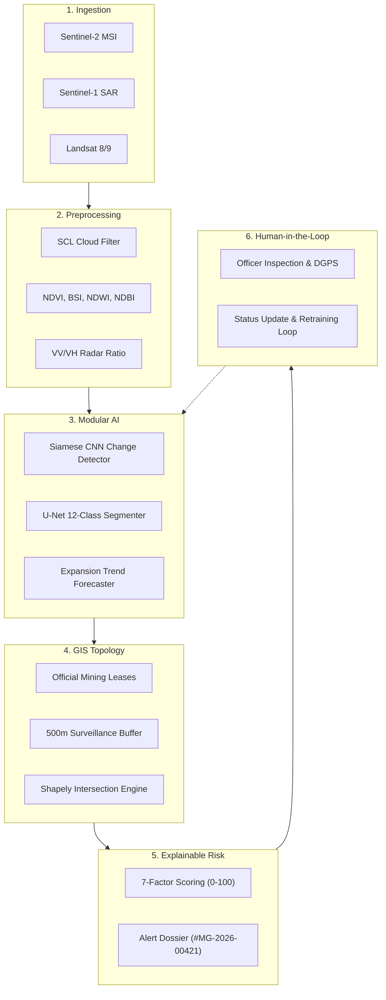

# Illegal Mining Detection by Using Satellite Data System Architecture

## Overview
Illegal Mining Detection by Using Satellite Data is an AI-assisted satellite surveillance and early warning platform designed to monitor mining sectors, detect potential unauthorized mining disturbances, intersect them against official cadastral lease boundaries and statutory 500m surveillance buffers, calculate an explainable Risk Score (0-100), and guide human-in-the-loop field verification.

## Modular AI Strategy
- Base Interfaces: `BaseChangeDetectionModel`, `BaseSegmentationModel`, `BaseRiskModel`, `BasePredictiveExpansionModel`.
- The system decouples model interfaces from business logic so pre-trained PyTorch weights can be dropped in seamlessly.
